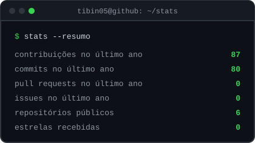
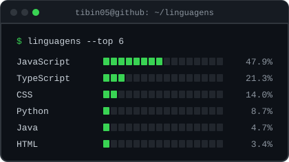

<p align="center">
  
</p>

<p align="center">
  
</p>

## ~/sobre

```console
tibin05@github:~$ cat sobre.txt
Estudante de Engenharia de Computação na FIAP.
Aqui ficam os projetos da faculdade: uma plataforma de risco urbano
para São Paulo, um sistema de controle de missão espacial (API + app
mobile), um sistema web de gestão de EPI e meu portfólio de
Engenharia de Software em Python.
tibin05@github:~$ ls projetos/
radar-urbano/  space-mission-gs/  epiguard/  checkpoint3-engenharia-software/
```

## ~/tecnologias

<p>
  
</p>
<sub>JavaScript · TypeScript · HTML · CSS · React Native (Expo) · Python</sub>

## ~/projetos

<table>
  <tr>
    <td width="50%" valign="top">
      <sub><code>~/radar-urbano</code></sub>
      <h3>Radar Urbano</h3>
      <p>Plataforma de risco urbano para São Paulo, feita na Global Solution 2026.2. Monitora alagamentos, ilhas de calor e interrupções de energia, água e transporte, e mostra a origem e o nível de confiança de cada dado.</p>
      <p>
        
        
        
      </p>
      <a href="https://github.com/Tibin05/radar-urbano"></a>
      <a href="https://radar-urbano-gamma.vercel.app"></a>
      <a href="https://youtu.be/Kckm9GjkLY4"></a>
    </td>
    <td width="50%" valign="top">
      <sub><code>~/space-mission-gs</code></sub>
      <h3>Controle de Missão Espacial</h3>
      <p>Sistema para monitorar missões espaciais: sensores, sistemas operacionais e alertas críticos em tempo real. API REST em Spring Boot e app mobile em React Native com Expo. Global Solution 2026.</p>
      <p>
        
        
        
      </p>
      <a href="https://github.com/Tibin05/space-mission-gs"></a>
    </td>
  </tr>
  <tr>
    <td width="50%" valign="top">
      <sub><code>~/epiguard</code></sub>
      <h3>EPIGuard</h3>
      <p>Sistema web de gestão de EPI industrial: controle de uso, validade, entrega e devolução de equipamentos de segurança. Desenvolvido em três entregas (CP4, CP5 e CP6) da disciplina de Engenharia de Software.</p>
      <p>
        
        
      </p>
      <a href="https://github.com/Tibin05/epiguard"></a>
    </td>
    <td width="50%" valign="top">
      <sub><code>~/checkpoint3-engenharia-software</code></sub>
      <h3>Portfólio de Engenharia de Software</h3>
      <p>Portfólio individual da disciplina de Engenharia de Software (FIAP 2026). Cada pasta é uma aula, com o código em Python, os diagramas UML e o print da execução.</p>
      <p>
        
      </p>
      <a href="https://github.com/Tibin05/checkpoint3-engenharia-software"></a>
    </td>
  </tr>
</table>

## ~/stats

<p align="center">
  
  
</p>

<p align="center">
  
</p>

<p align="center">
  
</p>

<p align="center">
  
</p>

<p align="center">
  
</p>

## ~/contato

<a href="https://www.linkedin.com/in/eric-siciliano-1463aa450/"></a>

<br>

<p align="center">
  <code>tibin05@github:~$ logout</code><br>
  <sub>Conexão com github.com encerrada. Valeu pela visita.</sub>
</p>
